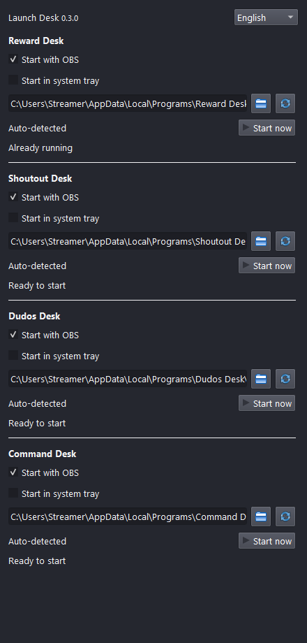

# Launch Desk OBS

[Русский](README.ru.md) · [Українська](README.uk.md)

**For streamers who often forget to start their apps before going live.**

A small OBS dock that starts desktop applications when OBS opens. Built-in discovery for **Reward Desk**, **Shoutout Desk**, **Dudos Desk** and **Command Desk**, custom programs and named startup sets. Windows 10/11 x64, OBS Studio 32+ with Qt 6.8+.

## Setup

1. Install the apps you need: Reward Desk, Shoutout Desk, [Dudos Desk](https://github.com/foolka/dudos-desk) or [Command Desk](https://github.com/foolka/command-desk). Complete their initial setup normally. This plugin does not install or sign in to them.
2. Close OBS completely. Download the EXE from [Releases](https://github.com/foolka/launch-desk-obs/releases) and install it. Setup never closes OBS or starts a stream.
3. Open OBS, then **Docks > Launch Desk**. Registered installations are detected automatically.
4. For a portable or moved app, choose its **RewardDesk.exe**, **ShoutoutDesk.exe**, **DudosDesk.exe** or **CommandDesk.exe** using the folder button. Do not select the installer or an OBS plugin.
5. Enable **Start with OBS** separately for each app. Initially all switches are off. Changes are saved immediately and take effect at the next OBS start. **Start now** launches without restarting OBS.
6. Choose **Start in system tray** independently for each built-in app. Checked opens only the tray icon; unchecked opens the normal window. Use current app versions; Reward Desk requires 0.10.2+ and Shoutout Desk 0.7.1+.

## Custom Apps and Startup Sets

**Add application** accepts a local Windows EXE or a Windows shortcut pointing to an EXE. Shortcut arguments and working directory are imported; both can be edited. New entries are disabled until you enable **Start with OBS**. This is for installed desktop programs, not installers, URLs, scripts, network paths or Store shortcuts without an EXE. For custom apps, tray behavior is controlled by the app's own settings or documented arguments; no Desk-specific flags are added.

Choose the startup set at the top. Its menu creates, duplicates, renames and deletes sets, for example Normal stream and VR. Up to 20 sets, each with up to 100 custom entries. The selected set is used at the next OBS start. Switching, adding or duplicating sets never launches or closes programs. Removing an entry/set does not uninstall anything. Deleting asks for confirmation; the final set cannot be deleted. Already running apps are still detected across sets.

## Behavior

- Starts once after OBS finishes loading, including when the dock is hidden. Scene/profile changes do not trigger another launch.
- Checks running processes before launching; skips an existing instance or another copy of the same executable name.
- Automatic paths are detected on each OBS start. Manually selected paths are preserved; moving a portable folder requires selecting its new EXE.
- Uses the Windows Explorer desktop user, without requesting administrator rights for the apps. If OBS runs as a different Windows user, launching is blocked to avoid opening the wrong profile.
- Each app can start normally or in the system tray. The selection also applies to **Start now** and never hides an app that is already running. Old 0.1.0 settings retain their previous modes until you change them.
- Does not close apps when OBS exits, restart crashed apps in a loop, alter scenes, or control streaming/recording.
- RU / UK / EN switch instantly. The dock follows the OBS theme.
- The app list scrolls in short docks. Updates preserve all existing paths, language and switches. New apps, including Command Desk in 0.3.0, always start with autostart off. Starting Dudos Desk does not activate an effect. Command Desk uses its own saved command switches.
- Status means the **process** is running, not that Twitch is connected or a browser source is working. Check those inside each app.

Use this with the **standalone desktop apps**, not with Reward Desk OBS / Shoutout Desk OBS. Do not run the standalone app and corresponding plugin for the same channel at once.

## ZIP / Portable OBS

Close all OBS instances. For installed OBS, copy the `launch-desk-obs` folder from the ZIP to `%PROGRAMDATA%\obs-studio\plugins\` (administrator permission may be required).

For an OBS ZIP distribution with `portable_mode.txt` enabled, copy only `launch-desk-obs/bin/64bit/launch-desk-obs.dll` into `<OBS>/obs-plugins/64bit/`. No extra runtime files or Qt DLLs are needed. Start that portable OBS as usual; its separate settings are in `<OBS>/config/launch-desk-obs/settings.json`.

## Updates, Data and Privacy

Install a newer EXE over the old version with OBS closed, or replace the DLL from ZIP. Settings are preserved. Uninstallation removes plugin files, not settings or app data.

Installed OBS settings: `%LOCALAPPDATA%\Launch Desk OBS\settings.json`. Stores all sets, the active set, program paths, arguments, working directories, switches and UI language. Do not put passwords or tokens in arguments. All sets are saved atomically in one file. Versions 0.1–0.3 load into one Default set with their previous choices. Opening the panel does not rewrite the file; the first edit saves an immutable `settings.json.<hash>.bak` before migration. Later edits keep the previous valid document in `settings.json.previous.bak`. If a backup or write fails, existing data remains; damaged/future settings are not silently reset. Installed and portable OBS deliberately have separate profiles; copy a backed-up file explicitly if moving between them. A backup never automatically overwrites another nonempty profile.

The panel checks this product's latest stable GitHub Release 10 seconds after opening, then every 6 hours, or when you press the refresh icon in the header. A newer version displays a notice and an **Open release** button. It never downloads/runs an installer automatically or offers a downgrade from a newer local version. Network failures do not affect startup or saved data.

The check sends an HTTPS request to `api.github.com` with the plugin version, not your sets or paths. No Twitch credentials, reward databases, chat records, analytics, telemetry or network listener. All application profiles remain owned by their original apps.

Unsigned installer: Windows may show publisher/SmartScreen prompts. Verify the release source and SHA256; do not disable Windows security features. Other OBS UI plugins can affect docks; report your OBS version and reproduction steps without credentials.

## Development

Node.js 24, Visual Studio C++ Build Tools (2019/2022), CMake, Windows SDK. `npm run build` downloads the official pinned OBS Qt SDK and verifies SHA256, or uses `QT_SDK`. `npm test` checks settings, paths, process detection and localized narrow dock layouts. `LAUNCH_DESK_PROCESS_TEST=1` additionally launches only a hidden test fixture through Explorer. `npm run package` needs Inno Setup 6 (`ISCC_EXE`) and produces EXE/ZIP with checksums.

Only stable public OBS frontend exports are resolved at runtime. No OBS or Qt DLLs are shipped. GPL-2.0-or-later; see [LICENSE](LICENSE) and [third-party notices](THIRD_PARTY_NOTICES.md).
