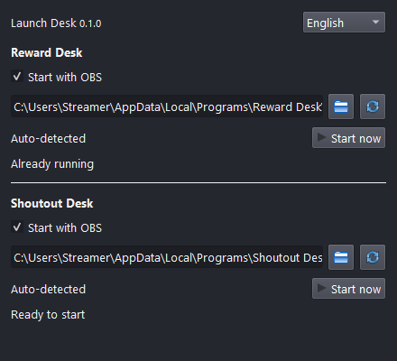

# Launch Desk OBS

[Русский](README.ru.md) · [Українська](README.uk.md)

**For streamers who often forget to start their apps before going live.**

A small OBS dock that starts the standalone **Reward Desk** and **Shoutout Desk** apps when OBS opens. Windows 10/11 x64, OBS Studio 32+ with Qt 6.8+.

## Setup

1. Install Reward Desk and/or Shoutout Desk and complete their initial setup normally. This plugin does not install or sign in to them.
2. Close OBS completely. Download the EXE from [Releases](https://github.com/foolka/launch-desk-obs/releases) and install it. Setup never closes OBS or starts a stream.
3. Open OBS, then **Docks > Launch Desk**. Registered installations are detected automatically.
4. For a portable or moved app, choose its **RewardDesk.exe** or **ShoutoutDesk.exe** using the folder button. Do not select the installer or an OBS plugin.
5. Enable **Start with OBS** separately for each app. Initially both switches are off. Changes are saved immediately and take effect at the next OBS start. **Start now** launches without restarting OBS.

## Behavior

- Starts once after OBS finishes loading, including when the dock is hidden. Scene/profile changes do not trigger another launch.
- Checks running processes before launching; skips an existing instance or another copy of the same executable name.
- Automatic paths are detected on each OBS start. Manually selected paths are preserved; moving a portable folder requires selecting its new EXE.
- Uses the Windows Explorer desktop user, without requesting administrator rights for the apps. If OBS runs as a different Windows user, launching is blocked to avoid opening the wrong profile.
- Shoutout Desk opens in its tray mode. Reward Desk currently opens its normal window.
- Does not close apps when OBS exits, restart crashed apps in a loop, alter scenes, or control streaming/recording.
- RU / UK / EN switch instantly. The dock follows the OBS theme.
- Status means the **process** is running, not that Twitch is connected or a browser source is working. Check those inside each app.

Use this with the **standalone desktop apps**, not with Reward Desk OBS / Shoutout Desk OBS. Do not run the standalone app and corresponding plugin for the same channel at once.

## ZIP / Portable OBS

Close all OBS instances. For installed OBS, copy the `launch-desk-obs` folder from the ZIP to `%PROGRAMDATA%\obs-studio\plugins\` (administrator permission may be required).

For an OBS ZIP distribution with `portable_mode.txt` enabled, copy only `launch-desk-obs/bin/64bit/launch-desk-obs.dll` into `<OBS>/obs-plugins/64bit/`. No extra runtime files or Qt DLLs are needed. Start that portable OBS as usual; its separate settings are in `<OBS>/config/launch-desk-obs/settings.json`.

## Updates, Data and Privacy

Install a newer EXE over the old version with OBS closed, or replace the DLL from ZIP. Settings are preserved. Uninstallation removes plugin files, not settings or app data.

Installed OBS settings: `%LOCALAPPDATA%\Launch Desk OBS\settings.json`. Only executable paths, two enable switches, detection mode and UI language are stored. Writes are atomic. A damaged or unsupported configuration is preserved and disables autostart instead of resetting it. Back up this file before manually editing or replacing it.

No Twitch credentials, reward databases, chat records, analytics, telemetry, network listener or automatic update service. The plugin makes **no network requests**. All application profiles remain owned by their original apps.

Unsigned installer: Windows may show publisher/SmartScreen prompts. Verify the release source and SHA256; do not disable Windows security features. Other OBS UI plugins can affect docks; report your OBS version and reproduction steps without credentials.

## Development

Node.js 24, Visual Studio C++ Build Tools (2019/2022), CMake, Windows SDK. `npm run build` downloads the official pinned OBS Qt SDK and verifies SHA256, or uses `QT_SDK`. `npm test` checks settings, paths, process detection and localized narrow dock layouts. `LAUNCH_DESK_PROCESS_TEST=1` additionally launches only a hidden test fixture through Explorer. `npm run package` needs Inno Setup 6 (`ISCC_EXE`) and produces EXE/ZIP with checksums.

Only stable public OBS frontend exports are resolved at runtime. No OBS or Qt DLLs are shipped. GPL-2.0-or-later; see [LICENSE](LICENSE) and [third-party notices](THIRD_PARTY_NOTICES.md).
