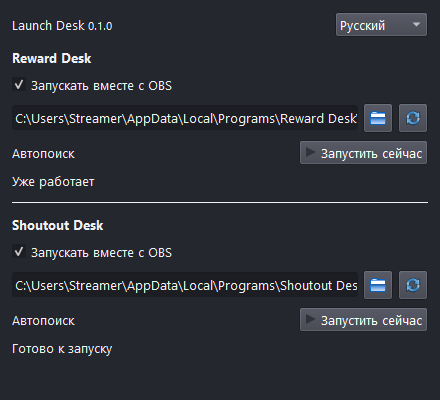

# Launch Desk OBS

**Для тех, кто часто забывает запустить приложения перед стримом.**

Плагин запускает самостоятельные **Reward Desk** и **Shoutout Desk** вместе с OBS. Windows 10/11 x64, OBS Studio 32+ с Qt 6.8+.

## Установка

1. Установите и настройте нужные приложения отдельно. Плагин не устанавливает их и не выполняет вход Twitch.
2. Полностью закройте OBS и установите EXE из [релиза](https://github.com/foolka/launch-desk-obs/releases). Установщик не закрывает программы и не прерывает эфир.
3. Откройте OBS → Док-панели → Launch Desk. Установленные приложения определятся автоматически.
4. Если используется portable или другая папка, выберите **RewardDesk.exe** / **ShoutoutDesk.exe** кнопкой папки. Не выбирайте установщик или OBS-плагин.
5. Включите «Запускать вместе с OBS» у нужных приложений. Изначально оба переключателя выключены. Настройки сохраняются сразу; автозапуск работает со следующего открытия OBS. Кнопка «Запустить сейчас» не требует перезапуска OBS.

## Что важно

- Уже работающая программа или другая её копия повторно не запускается. Смена сцены или профиля OBS не перезапускает приложения.
- Автоматический путь определяется заново при открытии OBS. Ручной путь сохраняется; после переноса portable выберите EXE снова.
- Приложения запускаются через Проводник Windows без запроса прав администратора. Если OBS открыт под другим пользователем Windows, запуск блокируется, чтобы не открыть чужой профиль.
- Shoutout Desk открывается в трее. Reward Desk пока открывает обычное окно.
- Закрытие OBS не закрывает приложения. Плагин не меняет сцены, не запускает эфир и не перезапускает упавшие приложения по кругу.
- Статус «Уже работает» подтверждает процесс, а не соединение Twitch или работу источника OBS.
- Русский, украинский и английский переключаются сразу; тема берётся из OBS.
- Нужен для самостоятельных приложений. Не включайте одновременно приложение и его OBS-версию для одного канала.

## ZIP, обновления и данные

Для обычного OBS при закрытой программе скопируйте папку `launch-desk-obs` из ZIP в `%PROGRAMDATA%\obs-studio\plugins\`. Для portable OBS с `portable_mode.txt` скопируйте DLL `launch-desk-obs/bin/64bit/launch-desk-obs.dll` в `<OBS>/obs-plugins/64bit/`. Другие DLL не нужны.

Обновление: закройте OBS и установите новый EXE поверх старого либо замените DLL из ZIP. Настройки сохраняются. Удаление плагина не удаляет настройки и данные приложений.

Настройки: `%LOCALAPPDATA%\Launch Desk OBS\settings.json`, а для portable OBS — `<OBS>/config/launch-desk-obs/settings.json`. Повреждённый файл не перезаписывается: автозапуск отключается. Перед ручными правками сохраните копию файла.

Плагин не читает базы наград и шотаутов, не требует Twitch-входа, не собирает статистику, не отправляет сетевые запросы. Установщик не подписан: Windows может показать системное предупреждение. Проверяйте источник загрузки и SHA256, не отключайте защиту Windows.

[Сборка и техническая документация](README.md#development) · [Лицензия](LICENSE)
