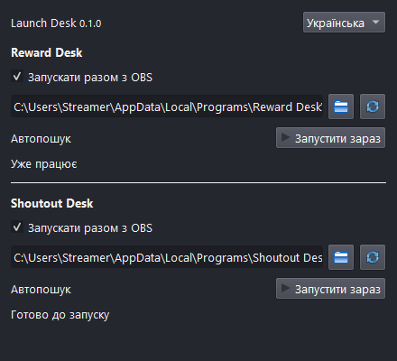

# Launch Desk OBS

**Для тих, хто часто забуває запустити програми перед стримом.**

Невеликий плагін запускає самостійні **Reward Desk** і **Shoutout Desk** разом з OBS. Windows 10/11 x64, OBS Studio 32+ з Qt 6.8+.

## Встановлення

1. Окремо встановіть і налаштуйте потрібні програми. Плагін не встановлює їх і не виконує вхід Twitch.
2. Повністю закрийте OBS та встановіть EXE з [релізу](https://github.com/foolka/launch-desk-obs/releases). Інсталятор не закриває програми й не перериває ефір.
3. Відкрийте OBS → Док-панелі → Launch Desk. Встановлені програми визначаються автоматично.
4. Для portable або іншої папки виберіть **RewardDesk.exe** чи **ShoutoutDesk.exe** кнопкою папки, а не інсталятор чи OBS-плагін.
5. Увімкніть «Запускати разом з OBS» окремо для кожної програми. Спочатку обидва перемикачі вимкнено. Зміни зберігаються одразу та діють із наступного запуску OBS. «Запустити зараз» працює без перезапуску OBS.

## Поведінка

- Запущена програма або інша її копія повторно не відкривається. Зміна сцени чи профілю OBS не повторює запуск.
- Автоматичний шлях перевіряється при відкритті OBS. Ручний шлях зберігається; після перенесення portable виберіть EXE знову.
- Запуск через Провідник Windows без запиту прав адміністратора. Якщо OBS відкрито під іншим користувачем Windows, запуск блокується для захисту профілю.
- Shoutout Desk відкривається у треї; Reward Desk поки відкриває звичайне вікно.
- Закриття OBS не закриває програми. Плагін не змінює сцени, не починає ефір і не перезапускає програми циклічно після збою.
- Статус підтверджує процес, а не з'єднання Twitch чи роботу джерела OBS.
- RU / UK / EN перемикаються одразу; тема відповідає OBS.
- Не використовуйте одночасно самостійну програму та її OBS-версію для одного каналу.

## ZIP, оновлення та дані

Для звичайного OBS при закритій програмі скопіюйте папку `launch-desk-obs` із ZIP до `%PROGRAMDATA%\obs-studio\plugins\`. Для portable OBS з `portable_mode.txt` скопіюйте DLL `launch-desk-obs/bin/64bit/launch-desk-obs.dll` до `<OBS>/obs-plugins/64bit/`. Інші DLL не потрібні.

Оновлення: закрийте OBS та встановіть новий EXE поверх старого або замініть DLL із ZIP. Налаштування зберігаються. Видалення плагіна не видаляє налаштування чи дані програм.

Налаштування: `%LOCALAPPDATA%\Launch Desk OBS\settings.json`, для portable OBS — `<OBS>/config/launch-desk-obs/settings.json`. Пошкоджений файл зберігається незмінним, автозапуск вимикається. Перед ручним редагуванням зробіть копію.

Жодного читання баз нагород чи шатаутів, входу Twitch, телеметрії або мережевих запитів. Інсталятор не підписано: Windows може показати системне попередження. Перевіряйте джерело та SHA256, не вимикайте захист Windows.

[Збірка та технічна документація](README.md#development) · [Ліцензія](LICENSE)
