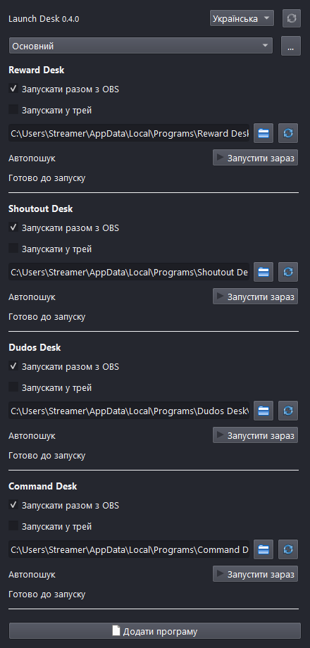

# Launch Desk OBS

**Для тих, хто часто забуває запустити програми перед стримом.**

Плагін запускає програми разом з OBS: автоматично знаходить **Reward Desk**, **Shoutout Desk**, **Dudos Desk** та **Command Desk**, дозволяє додавати власні програми й іменовані набори автозапуску. Windows 10/11 x64, OBS Studio 32+ з Qt 6.8+.

## Встановлення

1. Окремо встановіть і налаштуйте потрібні програми. Плагін не встановлює їх і не виконує вхід Twitch.
2. Повністю закрийте OBS та встановіть EXE з [релізу](https://github.com/foolka/launch-desk-obs/releases). Інсталятор не закриває програми й не перериває ефір.
3. Відкрийте OBS → Док-панелі → Launch Desk. Встановлені програми визначаються автоматично.
4. Для portable або іншої папки виберіть **RewardDesk.exe**, **ShoutoutDesk.exe**, **DudosDesk.exe** чи **CommandDesk.exe** кнопкою папки, а не інсталятор чи OBS-плагін.
5. Увімкніть «Запускати разом з OBS» окремо для кожної програми. Спочатку всі перемикачі вимкнено. Зміни зберігаються одразу та діють із наступного запуску OBS. «Запустити зараз» працює без перезапуску OBS.
6. Для вбудованих програм виберіть «Запускати у трей»: з позначкою буде лише значок біля годинника, без неї відкриється звичайне вікно. Використовуйте актуальні версії програм; для Reward Desk потрібна 0.10.2+, для Shoutout Desk 0.7.1+.

## Власні програми та набори

«Додати програму» приймає локальний EXE або ярлик Windows до EXE. Аргументи та робоча папка імпортуються з ярлика і редагуються окремо. Автозапуск нової програми спочатку вимкнено. Обирайте програму, не інсталятор: посилання, скрипти, мережеві шляхи та ярлики Store без EXE не підтримуються. Трей сторонніх програм налаштовується в них самих або їхніми документованими аргументами; прапорці Desk не додаються.

Угорі виберіть набір. Меню поруч створює, копіює, перейменовує та видаляє набори, наприклад «Звичайний ефір» і «VR». До 20 наборів, до 100 власних програм у кожному. Наступний запуск OBS використовує обраний набір. Перемикання й копіювання нічого не запускає та не закриває. Видалення запису або набору не видаляє програму з ПК; потрібне підтвердження, останній набір видалити не можна. Перевірка запущених програм діє між наборами.

## Поведінка

- Запущена програма або інша її копія повторно не відкривається. Зміна сцени чи профілю OBS не повторює запуск.
- Автоматичний шлях перевіряється при відкритті OBS. Ручний шлях зберігається; після перенесення portable виберіть EXE знову.
- Запуск через Провідник Windows без запиту прав адміністратора. Якщо OBS відкрито під іншим користувачем Windows, запуск блокується для захисту профілю.
- Для кожної програми можна вибрати звичайне вікно або трей, зокрема для «Запустити зараз». Уже відкриті вікна не приховуються. Після оновлення з 0.1.0 попередній режим зберігається до зміни позначки.
- Закриття OBS не закриває програми. Плагін не змінює сцени, не починає ефір і не перезапускає програми циклічно після збою.
- Статус підтверджує процес, а не з'єднання Twitch чи роботу джерела OBS.
- RU / UK / EN перемикаються одразу; тема відповідає OBS.
- У невисокій панелі список прокручується. Оновлення зберігає шляхи, мову та позначки попередніх програм. Command Desk у 0.3.0 додається з вимкненим автозапуском і використовує власні збережені перемикачі команд. Запуск Dudos Desk сам собою не активує ефект.
- Не використовуйте одночасно самостійну програму та її OBS-версію для одного каналу.

## ZIP, оновлення та дані

Для звичайного OBS при закритій програмі скопіюйте папку `launch-desk-obs` із ZIP до `%PROGRAMDATA%\obs-studio\plugins\`. Для portable OBS з `portable_mode.txt` скопіюйте DLL `launch-desk-obs/bin/64bit/launch-desk-obs.dll` до `<OBS>/obs-plugins/64bit/`. Інші DLL не потрібні.

Оновлення: закрийте OBS та встановіть новий EXE поверх старого або замініть DLL із ZIP. Налаштування зберігаються. Видалення плагіна не видаляє налаштування чи дані програм.

Налаштування: `%LOCALAPPDATA%\Launch Desk OBS\settings.json`, для portable OBS — `<OBS>/config/launch-desk-obs/settings.json`. Усі набори, активний вибір, шляхи, аргументи та позначки атомарно зберігаються в одному файлі. Не записуйте паролі чи токени в аргументи. Версії 0.1–0.3 читаються як набір «Основний» зі старими налаштуваннями. Відкриття панелі файл не змінює; перший запис нового формату створює незмінну копію `settings.json.<hash>.bak`, наступні зміни зберігають попередній справний файл `settings.json.previous.bak`. Помилки запису чи резервування не затирають дані. Пошкоджений або невідомий формат не скидається: автозапуск вимикається. Звичайний і portable OBS навмисно мають окремі профілі; для переходу перенесіть збережену копію явно. Копія не підміняє інший непорожній профіль автоматично.

Через 10 секунд після відкриття панелі й далі раз на 6 годин перевіряється останній стабільний GitHub Release. Кнопка оновлення в шапці перевіряє вручну. Новіша версія показує повідомлення та кнопку відкриття релізу; інсталятор сам не завантажується і не запускається. Пониження новішої локальної версії не пропонується. Помилка мережі не впливає на автозапуск і дані.

Перевірка надсилає HTTPS-запит до `api.github.com` із версією плагіна, але без шляхів чи наборів. Жодного читання баз інших програм, входу Twitch або телеметрії. Інсталятор не підписано: Windows може показати системне попередження. Перевіряйте джерело та SHA256, не вимикайте захист Windows.

[Збірка та технічна документація](README.md#development) · [Ліцензія](LICENSE)
